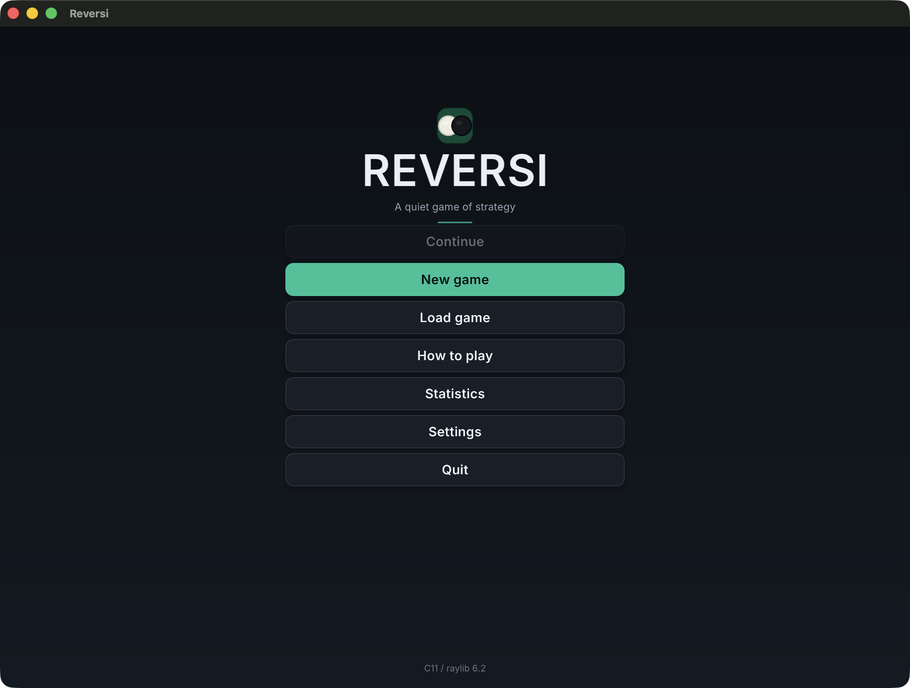
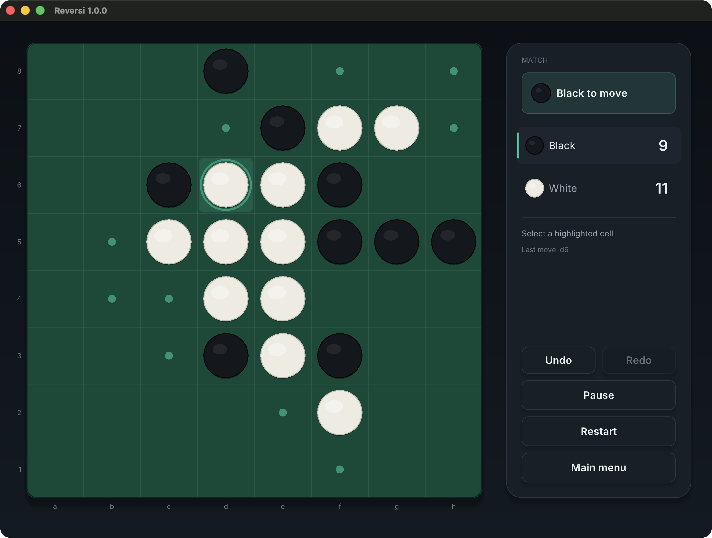
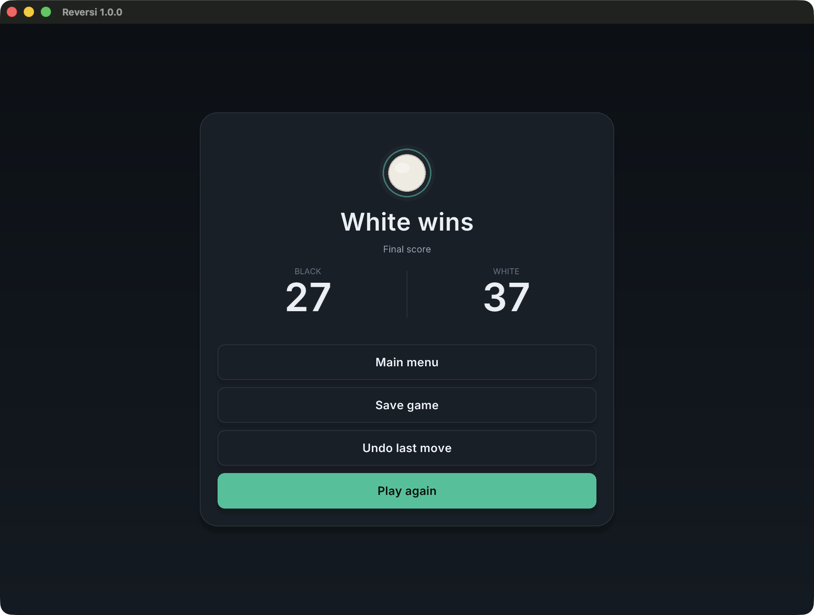

# Reversi

一款使用 **ISO C11** 与 **raylib 6.2** 编写的翻转棋（Reversi / Othello）桌面游戏。

> **源码版本：2.0.0（在线对战，尚未发布）。最新发行版为
> [v1.0.1](https://github.com/LightYourJourney/reversi-in-c/releases/tag/v1.0.1)。**
> 本地双人与人机对战均可完整走完一局。人机模式支持选择黑白方与
> Easy / Medium / Hard 三档难度；AI 在后台线程搜索，思考期间界面不冻结。
> Reversi Lab 提供独立于正式对局的复盘、MultiPV 分析与分支研究；
> 实验平台可复现地比较引擎配置并导出 CSV/JSON/Markdown/HTML 报告。
> Online play 提供临时房间的权威双人对战（本地服务端；未部署公网）。
> 存档/自动保存、继续上次对局、设置持久化、统计、规则帮助、程序化音效与
> 运行时明暗主题均已接入。存档使用带版本号、校验和与原子写入的文本格式，
> 损坏或不兼容文件会被安全拒绝。
>
> 发行包、安装/卸载、校验与签名限制见 [docs/RELEASE.md](docs/RELEASE.md)；
> 发布就绪性报告见 [docs/PHASE_7_REPORT.md](docs/PHASE_7_REPORT.md)。



| 对局 | 结算 |
|---|---|
|  |  |

## 功能

- 完整 Reversi 规则：八方向翻转、自动 Pass、终局与胜负/平局。
- 本地双人；人机执黑/执白；Easy / Medium / Hard 三档 AI。
- Bitboard 着法生成、增量 Zobrist；Hard 在 ≤12 空时使用精确残局求解器。
- 后台 AI 搜索、取消与快照隔离，思考期间界面保持响应。
- Reversi Lab：局面树、历史跳转、分支、自由摆盘、MultiPV、PV、
  评估分量、评分曲线、分支比较、批次分析与版本化棋谱导入/导出。
- 可复现实验平台：配对开局与换色、固定种子、固定深度/节点/时间、
  Wilson 置信区间与 Elo、确定性回归、静态实验报告。
- 在线对战：独立网络层、权威服务端、房间代码、ready、断线重连、
  超时/投降；桌面与 Web 客户端共用同一协议。
- 撤销/重做、暂停、重开、历史、帮助、统计与结算页。
- 自动存档、3 个手动存档槽、严格校验与原子写入。
- 设置持久化、明暗主题、动画速度、合法提示与最后一步高亮。
- 程序化音效；无音频设备时静默降级。
- Inter 字体内置，缺失时回退 raylib 默认字体。
- 最小窗口 760×600，宽/窄两套布局，支持 HiDPI。

## 平台支持

| 平台 | 构建/测试 | GUI |
|---|---|---|
| macOS 11+ arm64 | 本机 Debug 26/26、Release 26/26、ASan+UBSan 26/26（无窗口）；GUI 30/30 | 实际窗口与鼠标点击流程已验证；无 Developer ID/公证 |
| Windows x64 | GitHub Actions 托管 VM（v2.0.0）：Debug 26/26（运行 `40303018155`），发行包 `--version` 冒烟 | 物理桌面 GUI NOT TESTED |
| Linux x86_64 | GitHub Actions 托管 VM（v2.0.0）：Debug 26/26、ASan+UBSan 26/26、Xvfb GUI 4/4 与发行包验收 | Xvfb 软件渲染已验证；物理桌面 NOT TESTED |
| Web（Chrome） | Emscripten 6.0.13；构建通过（v2.0.0）；本地 HTTPS/WSS 双客户端完成一局（Headless Chrome，见 `docs/WEB_ONLINE_TESTING.md`） | Chrome 桌面与移动模拟已验证；Safari/Firefox NOT TESTED |

GitHub Actions 运行器是虚拟机，不等同物理机验证。v1.0.1 发行文件与
SHA-256 见 [docs/RELEASES.md](docs/RELEASES.md)；具体命令、运行号与
未验证项见 [docs/PHASE_7_REPORT.md](docs/PHASE_7_REPORT.md)。

## 安装发行版

从 GitHub Release 下载对应平台的归档，按
[docs/RELEASE.md](docs/RELEASE.md) 解压运行：

- macOS：解压后打开 `Reversi.app`（仅 ad-hoc 签名，无 Developer ID/公证）。
- Windows：解压后运行 `reversi.exe`，保留同级 `assets\`。
- Linux：解压后运行 `./reversi`，保留同级 `assets/`。

用户设置、统计与存档写入系统用户数据目录，不写入安装目录。

## 浏览器版本（WebAssembly）

同一份 C11 规则、AI 与存档校验被编译为 WebAssembly。需要
Emscripten 6.0.13（默认安装于 `~/emsdk`）：

```bash
scripts/build-web.sh          # 生成 web/dist/
scripts/serve-web.sh 8080     # http://127.0.0.1:8080/
```

`web/dist/` 是可部署的静态目录，附带 `_headers`（MIME、缓存与安全头）。
没有使用 SharedArrayBuffer 或 pthreads，因此不需要 COOP/COEP。
AI 在独立 Web Worker 中运行，取消时终止 Worker，页面保持响应。
存档写入浏览器 `localStorage`，可在页面上导出/导入，但浏览器、隐私模式
或清理站点数据都可能删除它。

已知限制：Web 端以 CSS 分辨率渲染（raylib Web 的 HiDPI 路径会把画布
缩小 1/DPR）；Safari、Firefox 与真实移动设备未验证。构建、部署与测试
细节见 [docs/WEB_BUILD.md](docs/WEB_BUILD.md)。

## 技术栈

- ISO C11（核心逻辑与全部第一方代码，不使用编译器扩展）
- [raylib](https://www.raylib.com/) 6.2（窗口、渲染、输入）
- CMake 3.24+（构建）
- CTest（测试）

## 设计原则

- **规则层不依赖图形库**：`core/` 只使用 C 标准库，可在无窗口环境下测试。
- **AI 不接触 UI**：AI 只读取对局快照并返回落子，最终仍由规则层校验。
- **依赖单向**：`main -> app -> {ui, ai, storage, settings, audio, core}`；
  `settings -> storage -> core`，`audio/ui -> raylib`；不存在反向依赖。
- **对局状态只有一条写路径**：棋盘只能经 `match_apply_move()` 改动，
  它内部调用规则层并记录历史；UI 不接触 `Board` 的可写接口。
- **无隐式工作目录**：构建后字体资源复制到可执行文件旁；用户设置、统计与存档
  写入操作系统规定的用户数据目录，而不是程序安装目录。
- **严格警告**：第一方代码启用 `-Wall -Wextra -Wpedantic -Wshadow` 等检查。

## 目录结构

```text
.
├── CMakeLists.txt
├── src/
│   ├── main.c            程序入口与命令行解析
│   ├── core/
│   │   ├── board.[ch]    棋盘、坐标/记谱映射、棋子统计
│   │   ├── rules.[ch]    合法着法、翻转、无状态规则
│   │   ├── game.[ch]     回合、自动跳过、终局与结果
│   │   ├── history.[ch]  局面快照栈、撤销/重做、分支截断
│   │   └── match.[ch]    对局状态机、模式与 AI 边界、撤销语义
│   ├── ai/
│   │   ├── ai.[ch]       难度配置、评估入口、合法性兜底、同步控制器
│   │   ├── ai_eval.c     角点/机动性/位置/稳定子/前沿/奇偶评估
│   │   ├── ai_search.[ch] Negamax、Alpha-Beta、迭代加深、置换表
│   │   └── ai_worker.[ch] 后台搜索线程、快照、取消与结果回收
│   ├── ui/
│   │   ├── theme.[ch]    运行时明暗主题、字号、间距、圆角与时长令牌
│   │   ├── draw.[ch]     圆角面板、文字、按钮状态、程序化棋子
│   │   ├── fonts.[ch]    Inter 字体加载、HiDPI 缩放与回退
│   │   ├── animation.[ch] 落子/翻转动画（仅影响渲染）
│   │   ├── board_view.[ch] 棋盘、坐标、合法提示、最后一步
│   │   ├── menu_view.[ch] 主菜单（继续/新游戏/读档/帮助/统计/设置）
│   │   ├── setup_view.[ch] 新游戏页（模式与颜色选择）
│   │   ├── game_view.[ch] 对局页、操作按钮与响应式布局
│   │   ├── pause_view.[ch] 暂停浮层（含保存）
│   │   ├── history_view.[ch] 着法历史列表
│   │   ├── settings_view.[ch] 设置页（持久化）
│   │   ├── result_view.[ch] 结算页（含保存）
│   │   ├── help_view.[ch] 规则与操作说明
│   │   ├── stats_view.[ch] 对局统计
│   │   ├── saves_view.[ch] 存档槽位管理
│   │   └── modal.[ch]    退出/重开/返回/删除确认
│   ├── storage/
│   │   ├── storage.[ch]  用户数据目录、原子读写
│   │   ├── text.[ch]     存档/设置/统计共享的行拆分与整数解析
│   │   ├── save.[ch]     版本化存档、校验和、严格回放校验
│   │   └── stats.[ch]    统计记录、撤回与持久化
│   ├── settings/settings.[ch] 用户设置与持久化
│   ├── audio/audio.[ch]  程序化落子/翻转/按钮/胜负音效
│   ├── platform/web/     浏览器适配（localStorage、AI Worker、尺寸）
│   └── app/app.[ch]      页面路由、转场与主循环
├── tests/
│   ├── test_harness.h    极简测试断言
│   ├── test_helpers.h    棋盘/状态比较辅助
│   ├── test_oracle.h     随机测试用独立合法性 oracle
│   ├── test_board.c      core.board 测试
│   ├── test_rules.c      core.rules 测试
│   ├── test_game.c       core.game 测试
│   ├── test_random_games.c 随机合法对局测试
│   ├── test_history.c    core.history 测试
│   ├── test_match.c      core.match 测试
│   ├── test_ai.c         ai.core 测试（评估、搜索、PvE 完整对局）
│   ├── test_ai_worker.c  ai.worker 测试（快照、取消、生命周期）
│   ├── bench_ai.c        AI 基准（对局、节点/剪枝/耗时、局面探针）
│   ├── test_ui_button.c  按钮悬停/按下/释放/禁用测试
│   ├── test_ui_helpers.c 缓动/颜色、命中、各视图输入、动画插值测试
│   ├── test_ui_views.c   主题、菜单、设置、存档、帮助、统计视图动作测试
│   ├── test_save.c       存档往返、损坏/版本/状态校验、原子覆盖
│   ├── test_settings.c   设置往返与损坏文件回退
│   ├── test_stats.c      统计记录、往返与非法数据拒绝
│   ├── test_audio.c      无音频设备时的安全降级
│   ├── app_autoplay_test.cmake 自动完成一局的 GUI 集成检查
│   └── web/              Playwright 浏览器回归测试（构建产物不入库）
├── web/
│   ├── shell.html        页面容器（Emscripten shell）
│   ├── app.js / style.css / ai_worker_boot.js
│   └── dist/             生成的可部署目录（.gitignore）
├── docs/
│   ├── ARCHITECTURE.md   模块职责、依赖方向与数据流
│   ├── BUILD.md          构建、运行、测试、打包与平台说明
│   ├── RELEASE.md        安装、卸载、校验与发布流程
│   ├── RELEASES.md       已发布版本与 SHA-256 记录
│   ├── TESTING.md        测试矩阵、性能数据与未验证项
│   ├── images/           README 使用的实际窗口截图
│   ├── ROADMAP.md        分阶段交付计划
│   ├── PHASE_0_REPORT.md Phase 0 完成报告
│   ├── PHASE_1_REPORT.md Phase 1 完成报告
│   ├── PHASE_2_REPORT.md Phase 2 完成报告
│   ├── PHASE_3_REPORT.md Phase 3 完成报告
│   ├── PHASE_4_REPORT.md Phase 4 完成报告（含 AI 基准结果）
│   ├── PHASE_5_REPORT.md Phase 5 完成报告（存档、设置、音效与 UI 审查）
│   ├── PHASE_6_REPORT.md Phase 6 审计、测试、性能与交付报告
│   └── PHASE_7_REPORT.md Phase 7 发布工程与发布就绪性报告
├── assets/
│   └── fonts/            Inter 4.1（SIL OFL 1.1）
├── scripts/
│   ├── package.sh        Release 构建、测试与 CPack 打包
│   └── verify-package.sh 独立解压启动验收
├── cmake/Info.plist.in   macOS 应用包元数据模板
├── VERSION               语义化版本（1.0.1）
├── CHANGELOG.md          变更日志
├── THIRD_PARTY_NOTICES.md 第三方许可证
└── LICENSE              GPL-3.0
```

`storage/settings` 均不依赖 UI；存档与统计只通过 `storage` 提供的路径与
原子写入访问文件系统，规则层仍然只使用 C 标准库。

## 技术架构

代码按依赖方向分层，禁止反向依赖：

```text
main -> app -> { ui, ai, persistence, audio }
                 |       |        |
                 v       v        v
               raylib   core <- storage/settings
```

- `core`：纯 ISO C11 规则、历史与对局状态机，不依赖图形库。
- `ai`：Negamax/Alpha-Beta、置换表与后台 worker，只读取核心快照。
- `persistence`：版本化存档、设置与统计，负责原子文件写入。
- `ui`：raylib 绘制与输入，只通过 `const Match *` 读取对局。
- `app`：页面路由、动画、AI 生命周期与持久化编排。

`Match` 是唯一允许修改对局状态的入口；UI 不接触可写棋盘。详细模块职责与
数据流见 [docs/ARCHITECTURE.md](docs/ARCHITECTURE.md)。

## 规则引擎与对局流程

- `board`：8×8 棋盘、安全的格子读写、棋子统计、坐标与标准记谱互转。
- `rules`：单步合法性、八方向翻转、合法着法生成/计数、无状态落子。
- `game`：黑方先行、回合切换、自动跳过、主动跳过限制、终局与胜负/平局。
- `history`：局面快照栈（第 0 项为起始局面），每步记录落子方、记谱、翻转数
  与跳过事件；撤销后新落子会截断重做分支。
- `match`：对局状态机与模式；唯一允许写入对局状态的入口，负责历史记录、
  暂停/继续、撤销/重做、重开与终局判定。

坐标约定：行 0 为顶部，列 0 为左侧；记谱 `a1` 为左下角，`h8` 为右上角。
标准开局为 D4/E5 白、D5/E4 黑。

## AI 引擎

- **搜索**：Negamax + Alpha-Beta，显式 pass 节点，双方无着法时返回精确终局分；
  迭代加深、时间预算、取消回调、置换表（Hard）与着法排序。
- **评估**：角点、机动性、潜在机动性、位置权重、边稳定子、前沿子、棋子数与
  奇偶，按开局/中局/残局切换权重；Easy/Medium 只把基础分量计入总分，
  Hard 额外计入稳定子、前沿子与奇偶；所有分量值单独保存在 `AiEvaluation`
  中可检查。
- **难度**：Easy 为单层静态评估加随机扰动；Medium 为固定深度 Alpha-Beta +
  基础评估；Hard 为迭代加深 + 置换表 + 完整评估 + 残局扩展。三档均只返回
  合法着法。
- **线程边界**：`AiWorker` 复制状态快照在后台搜索；取消/完成用 C11 原子变量
  同步。后台线程不接触 `Match`、UI 或全局状态，结果仍由 `match_apply_move()`
  校验后应用。线程创建失败时退回同步搜索，再退化为第一个合法着法。
- **基准**：`reversi_ai_bench --games N` 用固定种子跑 Random/Greedy 与不同难度
  对局；对局使用固定深度（Easy 1、Medium 4、Hard 6）与 10 秒上限，使固定
  种子结果可复现；局面探针使用各难度实际参数。输出 W/D/L、非法着法、失败、
  未完成局数、节点数、剪枝率、置换表命中、平均耗时与最大深度；任何非法/
  失败/未完成都会使进程返回非零。实际结果见
  [docs/PHASE_4_REPORT.md](docs/PHASE_4_REPORT.md)。

### 状态机

对局逻辑状态（`MatchPhase`）与应用页面（`AppScreen`）是两个独立的维度：

```text
AppScreen:  MainMenu → GameSetup → Game → History ─┐
                 │       ↑              │              │
                 ├→ Help / Stats / Saves / Settings   │
                 └────────────── Result ←─────────────┘

MatchPhase: PLAYER_TURN ──落子──> ANIMATING ──动画结束─┬─> PLAYER_TURN
                 │      ↑                              ├─> PASSING_TURN ──> PLAYER_TURN
                 │      └──────────────────────────────┘                  └─> GAME_OVER
                 ├──暂停──> PAUSED ──继续──> PLAYER_TURN
                 └──轮到 AI──> AI_THINKING ──落子──> ANIMATING
                                      └──取消──> PLAYER_TURN
```

- 每个转换都有显式前置条件，非法的转换返回 `false` 且不改变任何状态。
- 输入按阶段门控：`ANIMATING`、`PASSING_TURN`、`PAUSED` 期间棋盘与操作按钮
  不接受输入，而不是依赖散落的布尔标志。
- 自动跳过仍由规则层的 `game_apply_move()` 内部完成；`Match` 只负责把
  “对手无子可下”这一事实翻译成短暂的 `PASSING_TURN` 提示，不改变规则。
- 终局且棋盘未满（双方都无子可下）时按终局处理，不会记录成一次跳过。

## 图形界面与交互

- **页面**：主菜单、新游戏、对局、历史、设置、结算、帮助、统计、存档管理；
  退出、重开、返回菜单与删除存档使用模态确认。
- **新游戏页**：模式（Local / Computer）、先手颜色与 AI 难度（Easy / Medium /
  Hard）；难度只在 Computer 模式可选。AI 控制器不可用时 Computer、颜色与
  难度按钮禁用，并显示原因。
- **人机对战**：轮到电脑时进入 `AI_THINKING`，状态栏显示 “Computer is
  thinking...” 动态提示；棋盘与暂停禁用，撤销/重开/返回菜单仍可用。搜索在
  后台线程执行，主线程继续渲染；撤销、重开、返回菜单、退出或开始新对局都会
  取消并回收旧搜索。电脑无子可下时沿用自动跳过提示。
- **对局页**：8×8 棋盘与坐标、当前回合、双方实时棋子数、合法着法提示、
  最后一步脉冲标记、状态文本；宽窗口使用侧栏（含 Undo/Redo/Pause/Restart/
  Main menu），窄窗口使用上下信息栏与底部五按钮操作栏。
- **自动跳过**：对手无子可下时显示 “X has no legal moves / Turn passed to Y”
  浮层，约 0.9 秒后自动继续；期间棋盘输入被禁用，Esc/P 立即跳过提示并暂停。
- **暂停**：Esc 或 P 打开浮层，提供 Resume / Save game / History / Restart /
  Main menu；继续后回到暂停前的阶段。
- **历史**：显示每一步的序号、落子方、记谱、翻转数与跳过标记；当前局面
  高亮为 CURRENT，撤销后可重做的行标记为 REDO 并置灰；支持滚轮与上下键滚动。
- **撤销/重做**：本地双人撤销一步；人机模式撤销到玩家上一个决策点（搜索中
  撤销会先取消 AI 搜索）。新落子会丢弃重做分支。
- **操作**：鼠标悬停/点击；方向键移动棋盘光标、Enter/Space 落子；
  `U`/`Ctrl/Cmd+Z` 撤销，`Y`/`Ctrl/Cmd+Shift+Z`/`Ctrl/Cmd+Y` 重做；
  `R` 重开、`M` 返回菜单、`P`/`Esc` 暂停、`H` 查看历史、
  `Ctrl/Cmd+S` 保存当前对局；各页面按钮支持方向键 + Enter，模态支持
  Enter/Esc；所有按钮均支持鼠标操作。
- **反馈**：非法落点红色闪框；落子缩放、翻转与最后一步动画只影响渲染，
  不修改 `Match`；落子动画期间棋盘与操作按钮均被禁用。动画中按 Esc/P 会
  立即结束动画并暂停；按 M/R 则立即结束动画并打开对应的返回/重开确认框。
- **设置（持久化）**：动画、动画速度、合法着法提示、最后一步高亮、音效开关、
  音量、默认 AI 难度与明暗主题。设置修改后原子写入用户数据目录，重启后恢复。
  Animations 关闭同时作为“减少动效”选项；动画速度影响落子/翻转、结算出现与
  页面转场。
- **存档**：每次稳定落子后自动保存；暂停菜单/结算页可保存到 3 个手动槽位；
  主菜单“继续”读取自动存档，“读取游戏”可加载或删除任意槽位。读档通过回放
  着法重建历史，严格校验版本、校验和、棋盘/回合/结果与每步合法性。
- **帮助与统计**：三页规则/操作说明；统计页显示总对局、人机 W/D/L、
  本地双人局数与平局数，以及 Easy/Medium/Hard 分难度的局数/胜/平/负。只有真正
  完成的对局才计数；结算后撤销会撤回该局记录，重新结束只计一次。
- **音效**：落子、翻转、按钮、胜利/失败/平局提示均由运行时代码合成，不依赖
  外部音频文件；没有可用音频设备时静默降级。
- **布局**：最小窗口 760×600，支持任意缩放；宽/窄两套布局；HiDPI 按显示器
  缩放加载字体；超长状态文本使用裁剪区域。
- **字体**：内置 Inter 4.1 Regular/SemiBold（SIL OFL 1.1）。资源缺失时自动
  回退到 raylib 默认字体并记录警告，不阻断启动。
- **程序化资源**：棋子、棋盘、阴影、按钮与提示均为绘制生成，不依赖贴图。

开发辅助（仅 Debug 构建；Release 不编译这些钩子）：

```bash
# macOS 应用包内可执行文件；Linux 为 ./build/bin/reversi
APP=./build/bin/Reversi.app/Contents/MacOS/Reversi

# 自动落子，快速走完一局并检查结算页；数值为随机种子，便于复现具体对局
REVERSI_AUTOPLAY=7 "$APP"

# 启用 F12 窗口截图，写入指定目录
REVERSI_SHOT_DIR=/tmp/reversi-shots "$APP"

```

## 构建

完整命令、依赖与离线构建说明见 [docs/BUILD.md](docs/BUILD.md)。

### 环境要求

- CMake **3.24** 或更高
- 支持 C11 的编译器（macOS 上为 Apple Clang）
- 首次配置时需要网络下载 raylib；若系统已安装 raylib 6.2，则直接复用
- 若本机使用 HTTP 代理，请设置标准环境变量，例如：

  ```bash
  export https_proxy=http://127.0.0.1:7897
  export http_proxy=http://127.0.0.1:7897
  ```

  代理只影响依赖下载，不会被写进工程配置。

### Debug

```bash
cmake -S . -B build -DCMAKE_BUILD_TYPE=Debug
cmake --build build -j
```

### Release 与发行包

```bash
./scripts/package.sh
```

该脚本执行 Release 配置、构建、CTest 与 CPack，产物位于
`build-release/package/`：macOS 为 `Reversi.app` 的 zip，Linux 为 zip 和
tar.gz，Windows 为 zip；每个归档附带 `.sha256`。也可以手动执行：

```bash
cmake -S . -B build-release -DCMAKE_BUILD_TYPE=Release \
  -DREVERSI_FORCE_FETCH_RAYLIB=ON
cmake --build build-release -j
ctest --test-dir build-release --output-on-failure
cd build-release && cpack -C Release -B package
```

若未指定 `CMAKE_BUILD_TYPE`，工程默认使用 `Debug`。版本号来自
[`VERSION`](VERSION)；`--version` 与应用窗口标题使用同一版本。

### 跨平台构建

**Windows（Visual Studio 生成器，多配置）**

```powershell
cmake -S . -B build -G "Visual Studio 17 2022" -A x64
cmake --build build --config Release
.\build\bin\Release\reversi.exe
```

需要 Visual Studio 2022 的“使用 C++ 的桌面开发”工作负载，以及可用的 OpenGL 驱动。

**Linux（单配置生成器）**

```bash
sudo apt install build-essential cmake libasound2-dev libx11-dev \
  libxrandr-dev libxi-dev libgl1-mesa-dev libglu1-mesa-dev \
  libxcursor-dev libxinerama-dev
cmake -S . -B build -DCMAKE_BUILD_TYPE=Release
cmake --build build -j
./build/bin/reversi
```

不同发行版的包名可能不同；raylib 通过其内置 GLFW 处理 X11/Wayland 后端。

> Windows（MSVC）与 Linux 的 Debug 构建和 15 个无窗口测试已在 GitHub
> Actions 托管 VM 上通过；Linux 另有 Xvfb 软件渲染 GUI 冒烟。托管运行器
> 不是物理机，Windows/Linux 物理桌面 GUI 仍未验证。

### raylib 依赖策略

1. 优先调用 `find_package(raylib 6.2 QUIET)` 使用系统安装版本；
2. 未找到时，通过 `FetchContent` 下载固定版本 **6.2**，并校验 SHA256：
   `df7a13129b1bec9e73a6962efff170beba310ee6eab8f94cd000b7316b4db5ee`；
3. 强制使用下载版本：

   ```bash
   cmake -S . -B build -DREVERSI_FORCE_FETCH_RAYLIB=ON
   ```

   发布脚本与发布 CI 始终启用该选项，保证发行包使用已审计的 6.2。

4. 离线或离线镜像环境可复用本地源码树：

   ```bash
   cmake -S . -B build \
     -DFETCHCONTENT_SOURCE_DIR_RAYLIB=/path/to/raylib-6.2
   ```

## 运行

macOS 构建产物是应用包：

```bash
open build/bin/Reversi.app
# 或直接运行包内可执行文件
./build/bin/Reversi.app/Contents/MacOS/Reversi
```

Linux 运行 `./build/bin/reversi`；使用多配置生成器（如 Visual Studio）时，
Windows 可执行文件位于 `build/bin/<Config>/reversi.exe`。发行包中的程序
可从任意工作目录启动，运行时资源位于应用包 `Contents/Resources/assets`
或可执行文件同级 `assets/`。

开发/CI 可让程序只渲染若干帧后自动退出，用于验证窗口能正常启动与关闭：

```bash
# macOS
./build/bin/Reversi.app/Contents/MacOS/Reversi --frames 10
./build/bin/Reversi.app/Contents/MacOS/Reversi --version
# Linux（Windows 对应 build\bin\<Config>\reversi.exe）
./build/bin/reversi --frames 10
```

退出码 `0` 表示正常初始化、渲染并关闭窗口。

## 测试

完整测试矩阵、性能数据与未验证项见 [docs/TESTING.md](docs/TESTING.md)。

```bash
ctest --test-dir build --output-on-failure
```

`core.*` 与 `ai.*` 测试目标不依赖 raylib，因此可在无图形环境运行：

- `core.board`：623 项断言；棋盘、坐标/记谱、边界与安全访问
- `core.rules`：227 项断言；开局着法、八方向翻转、多方向/多子翻转、间隙与边界
- `core.game`：115 项断言；合法/非法落子、自动跳过、主动跳过限制、终局与结果
- `core.random`：557,924 项断言；500 局确定性随机对局，用独立合法性 oracle
  校验每步，并检查棋子占用数、总数与终局不变量
- `core.history`：124 项断言；快照初始化、撤销/重做完整恢复、新落子截断重做
  分支、跳过事件与终局恢复、容量与空指针
- `core.match`：980 项断言；配置校验、阶段门控与暂停、自动跳过与终局、
  从暂停/终局重开、撤销/重做恢复一致性、模式切换、AI_THINKING、人机撤销、
  从着法序列恢复（含期望局面校验、终局恢复、非法序列与越界计数拒绝）
- `ai.core`：2,977 项断言；配置/名称、评估分量与难度化评估、大量局面的
  合法性、TT 与无 TT 搜索一致性、单步与 pass 局面、取消与确定性，以及
  6 局固定深度人机对局 + 1 局使用实际 Hard 参数（深度 10 / 500 ms）的完整对局
- `ai.worker`：22 项断言；后台搜索、状态快照隔离、取消、空指针与生命周期
- `storage.save`：91 项断言；往返、覆盖写入、缺失/截断/错误版本/错误校验和/
  非法着法/棋盘或回合不匹配/越界坐标拒绝、状态消息、路径校验、残留临时文件
- `storage.settings`：58 项断言；默认值、速度档位、文本解析、往返、损坏头/越界值/非法布尔拒绝、
  未知键向前兼容
- `storage.stats`：44 项断言；PVE/PVP 记录与撤回、人机视角胜负、往返、非法汇总拒绝
- `audio.noop`：2 项断言；未初始化设备时所有音效调用为安全空操作
- `ui.button`（30 项断言）不创建窗口，直接用合成 `UiInput` 校验按钮的
  悬停、按下、释放、移出取消、禁用、输入阻断与 reduced-motion 语义。
- `ui.helpers`（191 项断言）覆盖缓动/颜色、棋盘命中、合法格判断、提示可见性、显示名称/
  终局标题（含 PvE “You win/Computer wins”）、焦点跳转、对局输入门控、
  AI_THINKING 门控、新游戏难度选择、各视图的键盘与鼠标动作，以及动画插值。
- `ui.views`（35 项断言）覆盖运行时主题切换、菜单继续项、设置数值/开关动作、
  存档槽位保存/加载/删除、帮助翻页与统计页返回。

实际结果（2026-10-23，macOS arm64，v1.2.0 源码）：

| 构建 | 测试结果 |
|---|---|
| Debug（无窗口） | 26/26 通过 |
| Release（无窗口） | 26/26 通过 |
| ASan+UBSan（无窗口） | 26/26 通过，无 Sanitizer 报告 |
| Debug + GUI | 30/30 通过；含 `app.lab`、`app.net` 渲染冒烟 |
| 浏览器（Chrome） | v1.1.0 套件 9/9；v1.2.0–v1.4.0 浏览器复验 **NOT TESTED** |
| Web 构建 | Emscripten 6.0.13 编译通过（主 wasm 385 KB，Worker 58 KB） |
| GitHub Actions | v1.4.0 运行 `40288248734` 9/9 通过；v1.3.0 为 `40111155790` |

AI 基准（Release，Apple M3，seed `0x5EED1234`，每组 20 局，共 180 局）中
所有对局 `illegal=0 failures=0 unfinished=0`；Hard 对 Random/Greedy 20:0、
对 Medium 20:0、对 Easy 17:3；Medium 对 Easy 20:0 且对 Random 17:2:1；
Easy 对 Random 13:1:6、对 Greedy 11:9。完整数据见
[docs/PHASE_4_REPORT.md](docs/PHASE_4_REPORT.md)。

Phase 13 的实验平台见 [docs/BENCHMARK_METHODOLOGY.md](docs/BENCHMARK_METHODOLOGY.md)
与 [docs/experiments/index.html](docs/experiments/index.html)；7 组配对实验
与 100 局随机稳定性实验均无非法着法、超时或中止。

Phase 12 的分析基准（Release，MultiPV=3）：开局深度 8 约 61 ms，
中局 30 空深度 8 约 2.3 s，8 空残局精确求解约 11 ms。数据见
[docs/benchmarks/phase12-analysis.txt](docs/benchmarks/phase12-analysis.txt)，
架构见 [docs/ANALYSIS_ARCHITECTURE.md](docs/ANALYSIS_ARCHITECTURE.md)。

Phase 11 的 AI 2.0 在同一语料、同一时段做了固定深度 6 的 A/B：两套引擎
节点数完全相同，开局 73.8→9.7 ms、中局 516→198 ms、残局 12 空
72→8.6 ms。Hard 500 ms 下开局 7→10 层、中局 6→7 层、残局 12 空精确
（281→22.6 ms）。数据与测量环境见
[docs/PHASE_11_REPORT.md](docs/PHASE_11_REPORT.md)；引擎设计见
[docs/AI_ENGINE.md](docs/AI_ENGINE.md)。

GUI 冒烟测试默认不注册（需要可用的图形会话）。启用方式：

```bash
cmake -S . -B build -DREVERSI_ENABLE_GUI_TESTS=ON
cmake --build build -j
ctest --test-dir build --output-on-failure
```

`app.smoke` 运行 `reversi --frames 2`，验证窗口初始化与关闭；Debug 下还会注册
`app.autoplay`，用自动对局完成一局并核对统计只增加一次、终局自动存档已删除。

浏览器回归测试（需要 Node、系统 Chrome，以及已构建并启动的 Web 服务）：

```bash
cd tests/web && npm install
REVERSI_WEB_URL=http://127.0.0.1:8080 \
REVERSI_WEB_DEBUG_URL=http://127.0.0.1:8081 \
node tests/web/run-tests.js
```

完整对局用例需要 Debug Web 构建（自动对局钩子只在非 `NDEBUG` 下存在）；
不提供 `REVERSI_WEB_DEBUG_URL` 时该用例标记 SKIP。详见
[docs/WEB_BUILD.md](docs/WEB_BUILD.md)。

### Sanitizer（可选）

```bash
cmake -S . -B build-sanitize -DCMAKE_BUILD_TYPE=Debug \
  -DREVERSI_ENABLE_ASAN=ON -DREVERSI_ENABLE_UBSAN=ON
cmake --build build-sanitize -j
ctest --test-dir build-sanitize --output-on-failure
./build-sanitize/bin/Reversi.app/Contents/MacOS/Reversi --frames 5
```

Sanitizer 标志只作用于第一方目标，不会重新编译 raylib。macOS 上的
AddressSanitizer 不支持 LeakSanitizer，运行测试时请使用
`ASAN_OPTIONS=detect_leaks=0`。

## 已知问题

- raylib 自带的 `stb_vorbis.c` 在编译第三方源码时会产生一条
  `-Wtautological-compare` 警告。它不属于第一方代码，也不影响构建结果。
- 在 macOS 上配置阶段，raylib 自身会打印一条关于 OpenGL 已废弃的
  developer warning；这是 raylib 6.2 的既有提示。
- 用户数据目录：macOS `~/Library/Application Support/Reversi`，
  Linux `$XDG_DATA_HOME/reversi`（或 `~/.local/share/reversi`），
  Windows `%APPDATA%\Reversi`。设置、统计与存档均写入该目录。
- 存档只保存当前撤销分支；撤销后尚未重做的“未来”分支不会写入文件。
- v1.0.1 的窗口、字体、音频、自动对局、发行包启动与鼠标点击流程已验证；
  键盘导航未单独走查，也没有自动化 GUI 点击/键盘回归测试。相关动作由
  `storage.*`、`ui.views` 与 `core.match` 测试覆盖。
- v1.0.1 已于 2026-10-22 发布，包含 Phase 7 发布后的审查修正、应用图标
  与 CI 打包流程收敛。
- 音效设备初始化成功且音效加载无警告，但**未进行人工听感验证**；
  无音频设备路径由 `audio.noop` 与代码降级分支覆盖。
- 760×600 最小窗口的 Phase 5 新页面按布局常量核对，未逐页截图；
  Windows/Linux 物理机与桌面 GUI 仍未验证。
- Phase 4 界面已实际验证：难度与颜色选择、人机执黑/执白、思考提示、
  AI 自动落子、思考中撤销、重做后重新搜索、重开与确认框取消。
  完整人机对局到结算页、人机自动跳过提示、思考中关闭窗口这三项**未人工验证**；
  对应逻辑由 `ai.core` / `core.match` / `ai.worker` 测试覆盖。
- AI 基准每组 20 局（共 180 局），固定深度使结果可复现；仍不应把胜率当作
  精确估计。Windows 的 `CreateThread` 后端已由 GitHub Actions 上的
  `ai.worker` 测试执行；AI 测试进程经 macOS `leaks` 检测为 0 leaks，
  raylib/UI 进程未做泄漏检测。
- 在锁屏、显示器休眠或没有活动图形会话时，GLFW 无法获取主显示器，
  `app.smoke` 与手动运行都会以 “Failed to get primary monitor /
  Failed to initialize platform” 失败；解锁并保持显示唤醒后重跑即可。
- Windows 与 Linux 构建、测试、打包与 Linux Xvfb 包验收已在 GitHub
  Actions 托管 VM 上验证；物理机、Windows/macOS 桌面 GUI 与 Linux 原生
  Wayland 会话仍未验证。

## 文档

- [构建与运行](docs/BUILD.md)
- [安装、卸载与发布](docs/RELEASE.md)
- [发行记录与 SHA-256](docs/RELEASES.md)
- [测试与验证](docs/TESTING.md)
- [架构设计](docs/ARCHITECTURE.md)
- [路线图](docs/ROADMAP.md)
- [变更日志](CHANGELOG.md)
- [第三方声明](THIRD_PARTY_NOTICES.md)

Phase 0–6 报告记录各阶段当时的状态，保留原文；最新状态以 README、
[RELEASE.md](docs/RELEASE.md) 与 [PHASE_7_REPORT.md](docs/PHASE_7_REPORT.md)
为准。

- [Phase 0 报告](docs/PHASE_0_REPORT.md)
- [Phase 1 报告](docs/PHASE_1_REPORT.md)
- [Phase 2 报告](docs/PHASE_2_REPORT.md)
- [Phase 3 报告](docs/PHASE_3_REPORT.md)
- [Phase 4 报告](docs/PHASE_4_REPORT.md)
- [Phase 5 报告](docs/PHASE_5_REPORT.md)
- [Phase 6 审计报告](docs/PHASE_6_REPORT.md)
- [Phase 7 发布就绪性报告](docs/PHASE_7_REPORT.md)

## 许可证

本项目使用 **GNU General Public License v3.0**，详见 [LICENSE](LICENSE)。
raylib（zlib）与 Inter（SIL OFL 1.1）的声明见
[THIRD_PARTY_NOTICES.md](THIRD_PARTY_NOTICES.md) 与
[assets/fonts/OFL.txt](assets/fonts/OFL.txt)。
